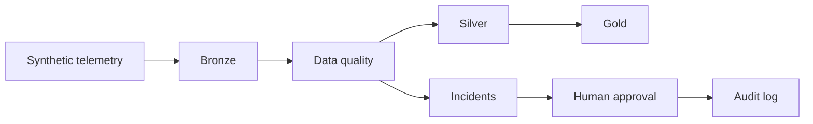

# Architecture

Phase 1 runs entirely on the workstation. The contracts are the part that stays the same on Databricks.

## Layers

| Layer | Dataset | Contents |
| --- | --- | --- |
| Bronze | `bronze.aircraft_telemetry` | Every generated row, including faults |
| Quarantine | `quarantine.aircraft_telemetry` | Rows that failed at least one rule |
| Silver | `silver.aircraft_telemetry` | Rows that passed every rule |
| Gold | `gold.flight_summary` | One summary per aircraft and flight |

`publish_medallion` replaces the local Delta snapshot for that batch. It is a full refresh of synthetic data, not a production merge.

## Rules

| Rule | Severity | Failure |
| --- | --- | --- |
| `event_id_unique` | high | `event_id` occurs more than once |
| `flight_id_not_null` | high | `flight_id` is null or blank |
| `fuel_non_negative` | critical | `fuel_remaining_kg` is below 0 |
| `altitude_in_range` | medium | `altitude_ft` is outside -1,500 to 65,000 |
| `engine_temp_not_null` | medium | `engine_temp_c` is null |

Each rule keeps a Spark SQL statement that selects the violating rows. The Python engine and `silver_frame` use the same bounds. The Spark test checks that both paths quarantine the same event ids.

Altitude limits cover airports slightly below sea level and reject readings above the transport-category envelope. They are a data contract, not a flight-dynamics model. Zero fuel and an engine temperature of 0 are valid. Only a missing temperature fails that rule.

## Incidents

A failed rule opens one incident:

`incident_id`, `detected_at`, `dataset`, `rule_name`, `severity`, `failed_record_count`, `sample_records`, `status`, `summary`.

`failed_record_count` is the full number of failing rows. `sample_records` keeps at most five JSON-ready rows. New incidents start as `open`.

## Human gate

`submit_human_decision` is the only status change. The actor and a non-empty note are required. A second decision on the same incident is rejected. The original incident object stays `open` because the model is immutable; the caller receives a new incident with status `approved` or `rejected`.

The audit log is append-only JSONL. Incident creation is attributed to the pipeline actor, for example `dq-engine`. Approval and rejection are attributed to the person who decided.

Deterministic quarantine is part of the data pipeline. An AI recommendation is not. Phase 1 has no writer that applies a recommended action to a Delta table.

## Local and Databricks

- Domain models are Pydantic, so the API and the tests share one contract.
- `src/pipelines/spark_medallion.py` is the DataFrame version of silver and gold. On Databricks, write those frames with `format("delta")`.
- Local files are Delta tables written with delta-rs, so Windows does not need Hadoop binaries. Databricks reads the same table format.
- `src/models/analysis.py` is the structured result a later model must return: root cause, evidence, impact, validation SQL, recommended action, verification steps, and a confidence score from 0 to 1.
